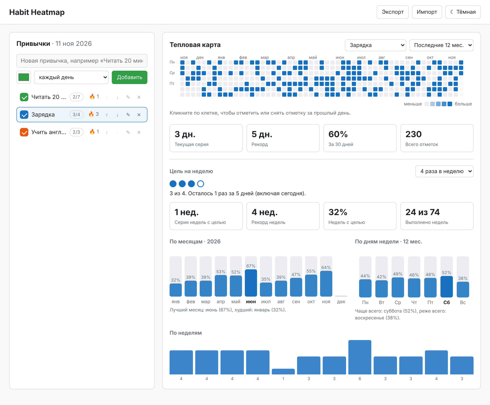
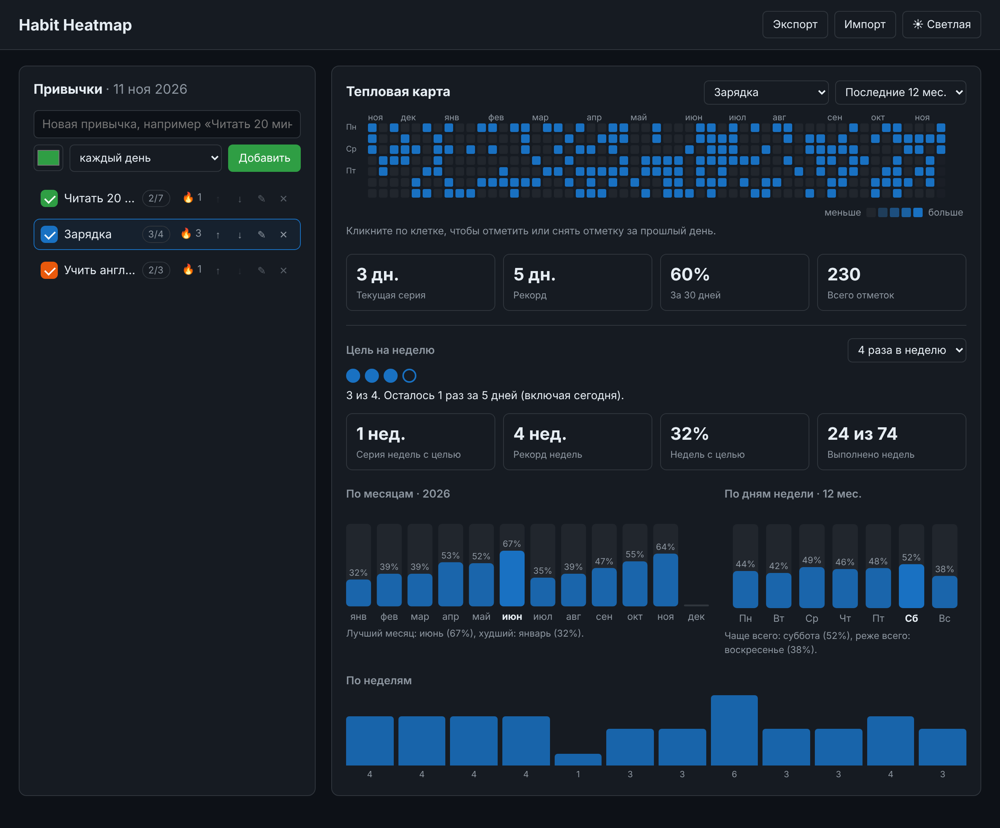

# Habit Heatmap

Трекер привычек с тепловой картой в стиле графика контрибуций GitHub. Отмечаете привычки каждый день, а на карте видно, как держится ритм за год.

Проект написан на чистом HTML, CSS и JavaScript (ES-модули), без фреймворков и бэкенда. Данные хранятся в `localStorage` браузера, работает офлайн.



<details>
<summary>Тёмная тема</summary>


</details>

## Возможности

- **Привычки:** добавление с выбором цвета, переименование прямо в списке, удаление, изменение порядка, проверка на пустые названия и дубликаты.
- **Отмена:** удаление и импорт можно отменить кнопкой «Отменить» в уведомлении, без всплывающих окон подтверждения.
- **Отметка за сегодня:** чекбокс в списке или горячие клавиши `1`–`9`.
- **Цель на неделю** *(v2)*: «каждый день» или от 1 до 6 раз в неделю. В списке виден прогресс недели (`2/3`, закрашивается при выполнении), в панели привычки — кружки прогресса и подсказка, сколько ещё осталось и успеваете ли вы до воскресенья.
- **Статистика по целям** *(v2)*: серия недель подряд с выполненной целью, рекорд, доля успешных недель.
- **Тепловая карта:** по всем привычкам сразу (яркость = сколько привычек выполнено) или по одной, в её цвете.
- **Переключатель года** *(v2)*: «последние 12 месяцев» или любой календарный год, за который есть данные. Выбор запоминается.
- **Графики по месяцам и дням недели** *(v2)*: процент выполнения с учётом даты создания привычки и ещё не наступивших дней, лучший и худший месяц, самый «сильный» и «слабый» день недели.
- **Редактирование истории:** выберите привычку и кликните по клетке прошлого дня, чтобы поставить или снять отметку. Будущие дни заблокированы.
- **Статистика:** текущая серия, рекордная серия, процент выполнения за 30 дней, общее число отметок.
- **График по неделям:** столбики за последние 12 недель.
- **Экспорт и импорт в JSON:** с проверкой формата и понятными сообщениями об ошибках. Файлы экспорта версии 1 импортируются и автоматически обновляются.
- **Миграция данных** *(v2)*: сохранённые в браузере данные первой версии подхватываются при первом запуске, а старая запись остаётся резервной копией.
- **Тема:** светлая и тёмная; по умолчанию берётся системная, выбор запоминается.
- **Демо-данные:** одной кнопкой (или параметром `?demo`): три привычки с разными целями и историей примерно за полтора года.
- **Адаптивная вёрстка:** число недель на карте подстраивается под ширину экрана, на телефоне нет горизонтальной прокрутки.
- **Защита от XSS:** пользовательский текст выводится только через `textContent`.

## Установка и запуск

Нужен [Node.js](https://nodejs.org/) версии 21 или новее. Для самого приложения зависимости не нужны.

```bash
git clone https://github.com/mrsolo743-dot/habit-heatmap.git
cd habit-heatmap
npm start            # http://localhost:8080
```

Можно обойтись и без Node, любым статическим сервером:

```bash
python -m http.server 8080
```

> Открыть `index.html` двойным кликом не получится: браузеры не загружают ES-модули по протоколу `file://`.

Полезные параметры адреса:

| Параметр | Что делает |
|---|---|
| `?demo` | загружает демо-данные примерно за полтора года |
| `?today=2026-11-06` | фиксирует «сегодняшнюю» дату (для тестов и скриншотов) |

## Тесты

```bash
npm test                       # 63 модульных теста: даты, модель и миграции, статистика и цели, карта, графики
npm install                    # один раз: ставит Playwright для браузерных тестов
npx playwright install chromium
npm run test:e2e               # 20 сквозных тестов в настоящем Chromium
npm run test:all               # всё вместе
```

Модульные тесты запускаются встроенным раннером `node:test` и не требуют зависимостей. Сквозные тесты открывают страницу в Chromium, проходят основные сценарии (добавление, отметки, клики по карте, перезагрузка, переименование, отмена удаления, экспорт и импорт, тема, горячие клавиши, XSS, мобильная ширина, цели на неделю, переключатель года, графики, миграция данных v1) и проверяют, что в консоли нет ошибок.

Пример вывода:

```
$ npm test
# tests 63
# pass 63
# fail 0

$ npm run test:e2e
ok 1 - пустое состояние и добавление привычки
ok 2 - дубликат названия показывает ошибку
...
ok 20 - данные старой версии (v1) мигрируют при запуске
# pass 20
# fail 0
```

Скриншоты для README пересоздаются командой `npm run screenshot`.

## Структура проекта

```
habit-heatmap/
├── index.html            # разметка приложения
├── css/
│   └── styles.css        # стили, светлая и тёмная темы
├── js/
│   ├── app.js            # точка входа: связывает данные и интерфейс
│   ├── store.js          # модель данных, валидация, миграции схемы, экспорт/импорт, localStorage
│   ├── stats.js          # серии, недельные цели, статистика по месяцам и дням недели
│   ├── heatmap.js        # сетка карты (последние N недель или календарный год) и отрисовка
│   ├── charts.js         # столбчатые SVG-диаграммы без библиотек
│   ├── format.js         # склонения («3 раза», «5 дней») и подписи
│   ├── dates.js          # работа с датами в формате YYYY-MM-DD
│   └── demo.js           # детерминированный генератор демо-данных
├── scripts/
│   ├── serve.mjs         # статический сервер без зависимостей
│   └── screenshot.mjs    # скриншоты для README
├── tests/
│   ├── unit/             # модульные тесты (node:test)
│   └── e2e/              # браузерные тесты (Playwright)
├── docs/                 # скриншоты
├── package.json
├── CHANGELOG.md
├── ИНСТРУКЦИЯ.md         # как проверить проект и обновить репозиторий
├── ОБЪЯСНЕНИЕ.md         # как устроен код и почему так
├── LICENSE
└── README.md
```

## Формат данных

```json
{
  "version": 2,
  "habits": [{ "id": "h_…", "name": "Читать 20 минут", "color": "#2f9e44", "createdAt": "2026-11-01", "goal": 5 }],
  "checks": { "h_…": ["2026-11-01", "2026-11-02"] }
}
```

`goal` — цель на неделю, целое число от 1 до 7 (7 = каждый день). В версии 1 этого поля не было: при загрузке или импорте таких данных всем привычкам ставится цель 7. История изменений — в [CHANGELOG.md](CHANGELOG.md).

## Лицензия

[MIT](LICENSE)
